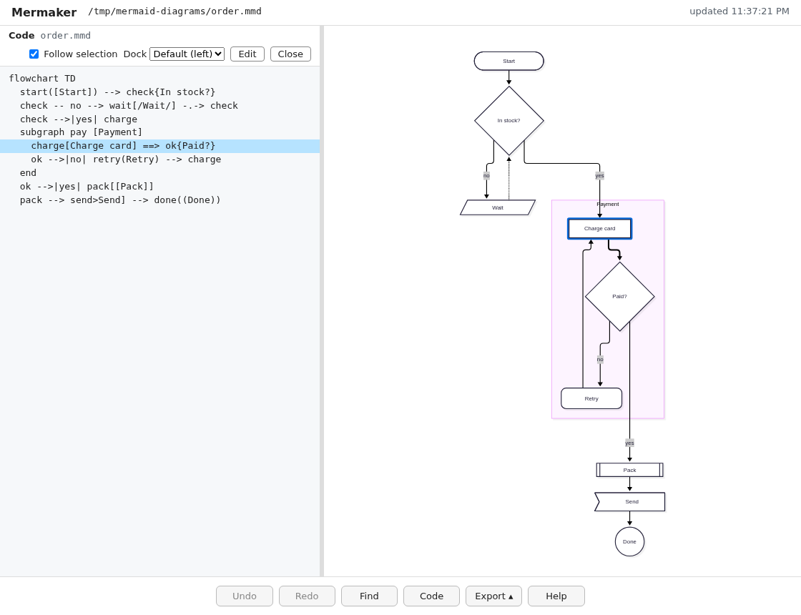

# Mermaker

Mermaker shows a Mermaid diagram file live in your browser, and lets you edit it by pointing and with keys. Each edit
is written back into the `.mmd` file as a small text change, so the file stays plain Mermaid and is the only source of
truth. You, your text editor and an AI agent can all work on the same file: the page redraws within a second whenever
the file changes, whoever saved it.

Mermaker edits flowcharts (`flowchart` and `graph`). Other diagram types are shown, but not edited.



## Getting started

You need Node 22 or later, and a browser with internet access: the page loads Mermaid from a CDN.

Install Mermaker from a clone of this repository:

```bash
git clone https://github.com/arcanemachine/mermaker.git
cd mermaker
npm install -g .
```

(`./run.sh` in the clone does the same as `mermaker`, without installing: use it if npm refuses to install for lack
of permissions.)

**Open one file:**

```bash
mermaker path/to/diagram.mmd
```

Mermaker prints the page's address; open it in your browser. Only that file is served. Add a port
(`mermaker diagram.mmd 6378`) to get the same address each time: if a Mermaker already serves the file there, it
prints that address instead of starting another.

**Serve a folder of diagrams** from one long-running server:

```bash
MERMAKER_ROOTS=/path/to/diagrams/ mermaker serve
```

Then open `http://localhost:63762/?f=<absolute path to a .mmd file>`. With no `MERMAKER_ROOTS`, the folder is
`/tmp/mermaid-diagrams/`; with no `?f=`, the page shows a scratch diagram there, made if missing. The address can also
open on one subgraph or node (`docs/guide.md`, Viewing).

Mermaker runs until you stop it (Ctrl+C).

## A skill for agents

Mermaker is made to work with AI agents: an agent edits the file, and the page follows it as you watch and edit
too. `mermaker skill` prints an agent skill (`SKILL.md`) that teaches an agent to use Mermaker: serve a diagram, give
you the page, and work on the same file with you. Save it as `mermaker/SKILL.md` in the folder your agent reads skills
from:

```bash
mkdir -p <skills folder>/mermaker
mermaker skill > <skills folder>/mermaker/SKILL.md
```

The skill is stamped with the version it came from and a hash of its text, so an agent can tell when its saved copy
differs from the Mermaker in use and offer to update it, keeping its Custom rules section.

## Using the page

Right-click (or touch and hold) a node, an edge, a subgraph or empty space for what you can do there. Double-click a
node or an edge to edit it. The Help button lists the main keys, and the Code button opens the file's code beside the
diagram. `docs/guide.md` says what every gesture, menu item and key does.

## Settings

Settings are environment variables, read when Mermaker starts.

| Setting | What it does |
|---|---|
| `MERMAKER_ROOTS` | For `serve`: folders whose `.mmd` files may be served, comma-separated. Default `/tmp/mermaid-diagrams/` |
| `MERMAKER_PATH_MAP` | `server=host` path prefixes, comma-separated. The page shows a file's host path, for a server in a container |
| `MERMAKER_IDLE` | Seconds with no requests before the server exits. Unset or 0: it runs until stopped. An open page polls every second, but a browser may freeze or unload a tab left in the background, which then stops asking |
| `BROWSER` | For `mermaker <file>`: a command to open the page with, arguments allowed (`firefox --new-tab`). Unset: the address is only printed |
| `MERMAKER_MAX_EDGES` | The most edges a diagram may have. Default: Mermaid's 500 |
| `MERMAKER_MAX_TEXT` | The most characters a diagram's code may have, leaving out comments and frontmatter. Default: Mermaid's 50,000. Mermaid's drawing slows as diagrams grow, so a higher limit is no promise of a quick render |
| `MERMAKER_HOSTS` | Host names the page may be opened under, besides `localhost`, `127.0.0.1` and `[::1]` (and the bound address, when it is a single one), comma-separated. Requests addressed to any other name are refused, which stops DNS rebinding |

The server listens on `127.0.0.1` unless you give it a host: `mermaker serve [port] [host]`, defaults 63762 and
`127.0.0.1`.

## Security

Binding to anything other than `127.0.0.1` lets anyone who can reach the machine read and edit the served diagrams:
there is no login. Only `.mmd` files inside `MERMAKER_ROOTS` are served, and requests addressed to a host name the
server does not know are refused (`MERMAKER_HOSTS`).

## Contributing

`AGENTS.md` holds the rules for changing Mermaker and the map of its code; `docs/ux.md` holds the rules the page
follows, and why.

## License

MIT
